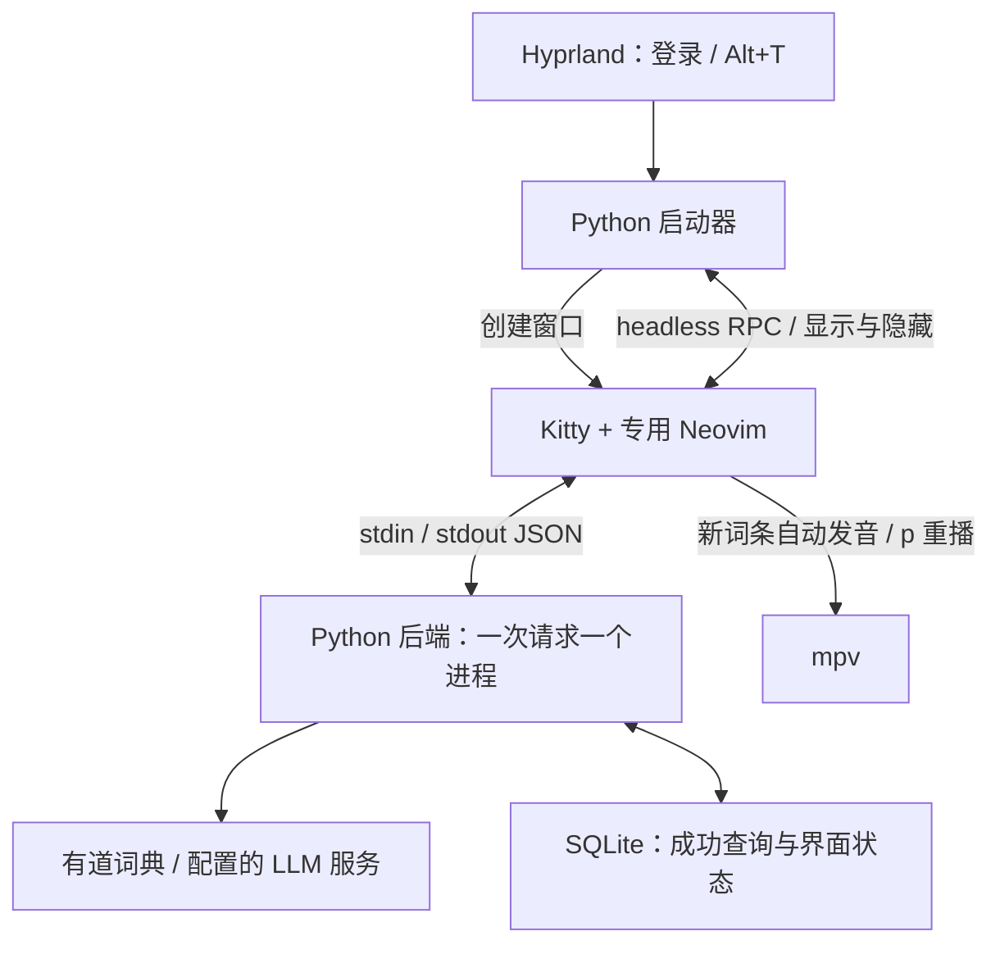

# Neovim Translator

在 Hyprland 上使用的键盘翻译器。独立 Kitty 窗口内运行专用 Neovim：登录后隐藏启动，`Alt+T` 调出，`:q` 保存并隐藏。窗口不参与平铺，普通终端和其他 Neovim 不加载本项目配置。

[目的](#目的) · [使用方法](#使用方法) · [实现方式](#实现方式) · [验证](#验证)

## 目的

阅读英文资料时，用快捷键随时查询词义或翻译句子；撰写英文时，也可将中文内容翻译成英文，再回到原来的工作窗口。输入区使用真实的 Vim 编辑能力，支持直接修改英文、查看词典义项和例句、听发音，以及回看历史。

这个组件由本仓库维护，使用独立的 Kitty 和 Neovim 实例承载界面；与日常编辑器分别保存配置和状态。下面先说明使用方法，再说明各部分如何配合。

## 使用方法

### 环境

- Hyprland 的 Lua 配置接口（本机 0.57），Kitty。
- Neovim 0.11+（使用 `vim.system`、`vim.fs`），Python 3.11+。
- `mpv` 播放词典发音；可选 `fcitx5-remote` 按翻译方向切换输入法。
- 不依赖额外的 Python 包或 Neovim 插件管理器。

当前桌面集成针对 Hyprland Lua API，不兼容旧版 `hyprland.conf` 的 hyprlang 调度命令。

### 启动与桌面接入

在项目目录运行：

```sh
python3 bin/translator start    # 仅启动，保持隐藏
python3 bin/translator toggle   # 显示 / 隐藏；未启动时先启动
python3 bin/translator show
python3 bin/translator hide     # 幂等，隐藏状态下不会被重新显示
python3 bin/translator status
python3 bin/translator stop     # 真正结束专用实例
```

在自己的 Hyprland Lua 配置中增加一行（替换成项目绝对路径）：

```lua
dofile("/absolute/path/to/translator/hyprland/translator.lua")
```

然后 `hyprctl reload`，并执行一次 `python3 bin/translator start`。之后每次登录由 `hyprland.start` 自动启动。配置片段默认绑定 `ALT + T`，与本机的主修饰键一致，可在片段中修改。Hyprland 的 `SUPER` 指 Win 键，与 `ALT` 是不同按键。也可运行 `python3 bin/translator config` 获取包含实际绝对路径的配置语句，二选一，避免重复绑定。

启动时安装仅匹配 `nvim-translator` app-id 的浮动规则，静默放入 `special:translator`。每次调出时，按窗口实际所在屏幕的逻辑可用区域重新居中：计算包含旋转方向、缩放比例和面板预留空间，四周留出 24 逻辑像素，以 900×600 为默认上限，小屏幕按可用空间缩小。特殊工作区跨屏时会保留旧屏的浮动偏移，因此不能只依赖初次创建窗口时的居中规则。调出会取得键盘焦点，隐藏后交还原桌面。

### 通过 dotfiles 同步

chezmoi 部署版本的程序位于 `~/.local/share/nvim-translator/`，入口为 `~/.local/bin/translator`。Hyprland 配置加载该目录中的 Lua 片段，因此另一台机器无需存在原开发目录。

```sh
# 在开发目录修改、验证后，更新 chezmoi 源目录中的程序及公开设置
python3 scripts/sync-dotfiles.py
# 然后在 dotfiles 仓库中审查、提交并推送
```

同步器只复制列明的代码、测试、文档及公开设置；不复制密钥、私有覆盖、历史、缓存和日志。若要写入另一个 checkout，可传 `--dotfiles /path/to/checkout`。其他机器执行 `chezmoi update` 后，运行 `hyprctl reload config-only`，再按 `Alt+T`；下次登录会隐藏启动。需自行安装本文列出的系统依赖。

后续修改公开设置可用 `chezmoi re-add ~/.config/nvim-translator/config.toml`；`config.local.toml` 保持本机私有，不要 re-add。

### 翻译方向

Normal 和 Insert 模式都可按 `Tab` 在 **EN→ZH（英译中）** 与 **ZH→EN（中译英）** 之间切换。状态栏始终显示当前方向。切换保留输入、光标、编辑模式和上一条结果，不会自动发起查询；按 `Ctrl+C`、`Esc` 或 `Enter` 后才提交。上一条结果标有它自己的方向，便于区分当前草稿与已显示的结果。

首次启动默认英译中；隐藏和重启会恢复上次的方向。`j/k` 浏览历史时会恢复该条记录的方向。同一段文本按不同方向翻译，分别保存和缓存。旧历史按英译中保留。

英译中的单词、短语沿用词典查询，句子使用 LLM；中译英直接使用配置的 LLM，因此也需要模型和凭据。未配置时显示配置提示，保留草稿和旧结果。

启用输入法管理后，Insert 模式在英译中时切英文、中译英时启用输入法；回到 Normal 模式切英文，便于使用 Vim 命令。隐藏窗口后恢复调出前的输入法状态，可通过 `ui.input_method=false` 关闭这项管理。

### LLM 配置

复制示例配置：

```sh
mkdir -p ~/.config/nvim-translator
cp config.toml.example ~/.config/nvim-translator/config.toml
chmod 600 ~/.config/nvim-translator/config.toml
```

英译中的词典查询可直接联网使用。句子翻译和中译英需要设置 `[llm]` 的 `protocol`、`base_url`、`model` 和凭据；空模型不会触发 LLM 请求。

| protocol | base_url 示例 | 自动追加的端点 |
| --- | --- | --- |
| `openai` | `https://api.openai.com/v1` | `/chat/completions` |
| `openai-responses` | `https://api.openai.com/v1` | `/responses` |
| `anthropic` | `https://api.anthropic.com/v1` | `/messages` |
| `gemini` | `https://generativelanguage.googleapis.com/v1beta` | `/models/MODEL:generateContent` |

`base_url` 是 API 根地址，不包含最后一段端点。模型名使用服务商实际支持的模型。

默认从 `TRANSLATOR_API_KEY` 环境变量读取凭据，可通过 `api_key_env` 改变量名。注意：仅在某个终端里 `export`，不代表登录时启动的 Hyprland 子进程也有这个变量。可以在桌面会话环境中配置，或在同目录的 `config.local.toml` 中设置：

```toml
[llm]
api_key = "在本机填写"
```

将私有文件权限设为 600。后端按字段合并 `config.toml` 和 `config.local.toml`，环境变量凭据优先；自定义 `foo.toml` 对应 `foo.local.toml`。dotfiles 只管理公开文件，私有覆盖被忽略。修改进程环境后重启翻译器；后端每次请求都会读取配置。修改 `[ui]` 的发音、例句或输入法设置后，用 `stop` 再 `start` 重启使界面设置生效。不要把真实密钥写入公开配置、项目示例或提交到仓库。

### 操作

焦点固定在上方输入行，下方显示结果。输入在逻辑上保持一行，长句横向滚动，多行粘贴合并为空格。

| 按键 | 行为 |
| --- | --- |
| Normal / Insert 中 `Tab` | 切换英译中 / 中译英，保留草稿，不自动提交 |
| `i/a/A`、`ciw`、`w/b/e`、`0/$`、`u` | 原生 Vim 编辑 |
| Insert 中 `Ctrl+C` / `Esc` / `Enter` | 回到 Normal 并查询 |
| Normal 中 `Ctrl+C` / `Esc` / `Enter` | 提交查询；内容未变时保留当前结果 |
| Normal 中 `k` / `j` | 更早 / 更新的历史，不循环、不重查 |
| `Ctrl+D` / `Ctrl+U` | 滚动下方结果 |
| Normal 中 `p` | 重播词典发音；因此此键不再是原生 Vim 粘贴，仍可用 `P` 或剪贴板粘贴 |
| `:q` / `:q!` | 保存草稿、光标和结果位置并隐藏，进程继续运行 |
| `:qa!` | 真正退出专用 Neovim，下次唤出恢复磁盘状态 |

只拦截交互命令行中精确的 `:q` / `:q!`；`:quit`、`:qa!` 等保留 Neovim 原生语义。在结果区点击后会回到输入区。其他原生窗口管理命令仍可改变专用 UI，因此日常使用建议保留默认两区布局。

新查询的词典词条默认自动发音一次。翻历史、窗口重开、命中历史缓存时不自动播放；句子不自动朗读。`[ui]` 可设置 `auto_pronounce`、`accent="us"/"uk"`、`examples`、`input_method`。

### 词典与历史

在线词典使用有道公开网页 JSON 接口，保留词条返回的全部中文释义、词性、音标及可获取的双语例句。没有例句时不编造；“全部”指该接口实际返回的义项，不承诺覆盖所有词典和专业领域。该接口不是带可用性承诺的商业 API，接口变化或联网失败会显示错误。

英译中支持长短语，不仅凭词数区分词组和句子。该方向的明确句子直接走 LLM，其他输入先尝试词典；词典真实未命中才进入 LLM。网络故障不会被伪装成“没有这个词”。LLM 输出显示为模型翻译，不冒充词典原文。失败保留草稿和旧结果，不写成功历史。

历史使用独立 SQLite 数据库。浏览不会改变顺序；修改旧查询后提交保留旧记录。相同文本和方向命中缓存，不新建重复历史。草稿与当前历史项分别保存，隐藏、正常退出时保存，编辑时短暂防抖保存；系统骤停仍可能丢失最后一小段尚未落盘的输入。旧查询稍后返回也不会覆盖正在编辑或浏览的内容。

默认路径：

- 配置：`$XDG_CONFIG_HOME/nvim-translator/config.toml`，默认 `~/.config/nvim-translator/config.toml`。
- 数据：`$XDG_DATA_HOME/nvim-translator/history.sqlite3`，默认 `~/.local/share/nvim-translator/history.sqlite3`。
- socket、启动锁和 Kitty 日志：`$XDG_RUNTIME_DIR/nvim-translator/`。

可用 `TRANSLATOR_CONFIG`、`TRANSLATOR_DB`、`TRANSLATOR_RUNTIME_DIR` 覆盖各路径。日志不记录 API 密钥。专用实例设置 `NVIM_APPNAME=nvim-translator`，不使用普通 Neovim 的配置、socket、ShaDa 或交换文件。

## 实现方式

### 调用流程



启动器按专用 app-id 查找或创建浮动窗口，将其放在 `special:translator` 工作区。显示工作区后，重新读取窗口实际所在的显示器，将物理分辨率转换为旋转、缩放后的逻辑工作区，扣除面板预留边距，再按窗口地址发送绝对尺寸和全局位置命令。这样切屏不会沿用旧屏的浮动偏移。Neovim 使用独立的 `NVIM_APPNAME`、初始化入口和 socket；启动器用 headless RPC 通知它准备显示或保存状态，再切换工作区。`:q` 保存并隐藏，`stop` 会结束实例并等待窗口退出。

Neovim 上方的可编辑缓冲区接收原生 Vim 操作，下方的只读缓冲区显示结果。查询通过 `vim.system` 异步启动 Python 后端，每次向 stdin 写一个 JSON 请求，从 stdout 读一个 JSON 响应；后端完成请求后退出。请求代次和缓冲区变更检查可防止旧响应覆盖新输入；切换方向也会使旧请求失去界面更新权限。`j/k` 读取已加载的历史记录，编辑中的草稿单独保存。

后端按文本和方向检查成功查询缓存；英译中时明确的句子走 LLM，其他输入先查有道词典，词典真实未命中时再尝试 LLM；中译英直接走 LLM。网络失败直接报错。成功结果与草稿、光标、结果滚动位置写入 SQLite，失败查询不进入成功历史。配置按公开 TOML、私有覆盖、环境变量凭据的顺序读取。

### 源码分工

| 部分 | 源码入口 | 负责的事情 |
| --- | --- | --- |
| 桌面接入 | [Hyprland 配置片段](hyprland/translator.lua) | `Alt+T` 和登录后隐藏启动 |
| 窗口与进程控制 | [启动器目录](bin/) | 创建 Kitty / Neovim、安装浮动规则、RPC、显示 / 隐藏 / 退出 |
| Vim 界面 | [初始化入口](nvim/init.lua)、[界面模块](nvim/lua/translator/init.lua) | 两个缓冲区、按键、异步查询、历史、状态保存、输入法与发音 |
| 请求分发 | [后端进程入口](translator_backend/__main__.py)、[应用层](translator_backend/app.py) | JSON 请求 / 响应、缓存查询、错误处理 |
| 翻译来源 | [词典](translator_backend/dictionary.py)、[LLM](translator_backend/llm.py) | 有道释义 / 例句 / 发音地址与四种 LLM 协议适配 |
| 配置与数据 | [配置读取](translator_backend/config.py)、[SQLite 存储](translator_backend/storage.py) | 字段校验、私有覆盖、成功查询历史和独立界面状态 |
| dotfiles 同步 | [同步脚本](scripts/sync-dotfiles.py) | 按文件清单复制代码和公开设置，生成 chezmoi 入口与配置 |

完整的后端请求、返回值和持久化字段见 [内部接口约定](INTERFACE.md)。chezmoi 源目录通过 `executable_`、`private_` 前缀编码安装权限；程序按前文的用户目录布局安装，密钥和运行数据仍由各机器本地保存。

## 验证

```sh
python3 -m unittest discover -s tests -p 'test_*.py' -v
NVIM_APPNAME=nvim-translator-test NVIM_LOG_FILE=/tmp/nvim-translator-test.log \
  nvim --headless -u NONE -i NONE -l tests/nvim_smoke.lua
```

后端协议测试使用本地 HTTP 服务验证请求体、认证头、各协议响应解析、失败处理和持久化，不需要付费调用。Neovim smoke 测试使用隔离数据。真实 LLM 效果仍需配置自己的服务后验证。

需要验证真实桌面时，可关闭现有翻译窗口后运行 `python3 tests/desktop_smoke.py`。它会暂时显示测试窗口，实际经 Hyprland 的快捷键启动环境切换显示/隐藏，再联网查询两个词条，并在所有已连接屏幕间来回唤出，检查旋转与缩放后的窗口边界、居中、隐藏、重启恢复和其他窗口布局；测试数据独立保留在项目 `.runtime` 下。该测试不能与正在使用的翻译实例同时运行。

本机验证结果：56 项 Python 测试通过，覆盖双向缓存、旧库并发初始化与迁移及旋转 / 缩放屏幕定位；Neovim smoke 已通过，覆盖 Normal / Insert 的 Tab 与方向恢复。本次在实际 Hyprland 双屏复现旧版越界，并验证修复后的两屏位置、边界及其他窗口布局。完整桌面脚本须在会话解锁后运行，锁屏会阻止键盘焦点切换。词典真实联网成功，发音音频通过 mpv 的静音输出解码验证。未使用真实 LLM 凭据或发出付费请求。
